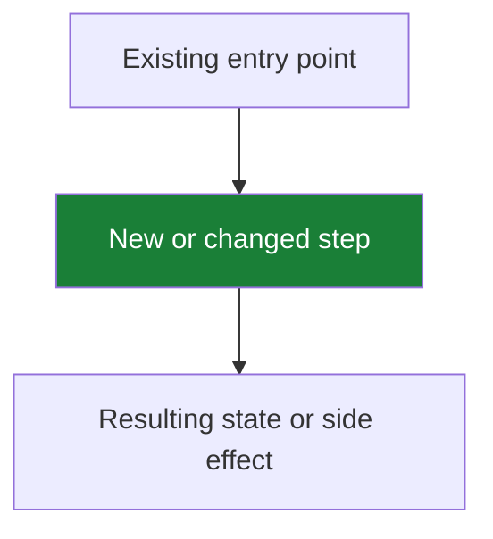

## Summary

What changed.

## What this work built

If the PR changes runtime behavior (host lifecycle, event admission, policy or state transitions, a tool or CLI command shape, console or TUI behavior), replace the placeholder below with 1–3 Mermaid diagrams. Draw the diff, not the whole system. Every node must trace to a change in this PR, or give minimal orientation context to a reviewer. Then delete these guidance bullets. If the PR has no runtime behavior delta (docs-only, styling, internal-only renames, test-only, or config/infra that changes no runtime behavior), write `N/A — no behavior delta` here. Keep the section and delete the rest.

- Pick the views that fit this change:
  - `flowchart TD` — workflow, state machine, branch / reject paths
  - `sequenceDiagram` — information flow between actors (host, CLI children, server, streams, console)
  - `erDiagram` — store document / ledger record / agent-file schema changes
  - `flowchart LR` — where this PR sits in a stack (highlight this PR, dash future work)
- Highlight the delta. In flowcharts and ER diagrams, color new or materially changed nodes green (`style NodeID fill:#1a7f37,color:#fff`, dark enough for white-text contrast). Color reject/failure paths `fill:#f8d7da,color:#24292f`. Color side effects and async waits `fill:#fff3cd,color:#24292f`. Leave pre-existing context unstyled. Never let color be the only signal; include `NEW` / `CHANGED` text in the node label itself. `style` does not apply to sequence diagrams. In sequence diagrams, mark the delta with labels instead (`Note over A,B: ...`, `NEW:` prefixes on messages).
- GitHub Mermaid rules: wrap labels that contain punctuation (`:`, `()`, `,`, `#`, `/`) in double quotes. Use ` ` inside labels, not literal newlines. Use stable alphanumeric node IDs.
- NEVER put lifecycle markers (`Part of #N`, `Closes #N`) inside a Mermaid fence or any other code fence; the marker parser does not match inside fenced code.

## Source issue

Fill the marker line below. Replace `#` with the issue number. Keep the marker on its own line, never inside a code fence. Pick exactly one form, then delete the guidance bullets:

Part of #

- `Part of #N` — first/middle PR in a stack (does not close the issue).
- `Closes #N` / `Fixes #N` / `Resolves #N` — final PR for the issue (closes it).
- `Refs #N` — related work only. It does NOT close anything.

## Ready for review (definition of done)

Opening a PR for review asserts the work is DONE, not that it is far enough along for a reviewer to finish it. Every box below is met before the PR leaves draft. An unmet box is a draft PR, not a review finding.

- [ ] **Acceptance criteria are written down and MET.** Not deferred, not "worth confirming later", not filed under "still open". An unsettled criterion is settled before review, with whoever owns the call.
- [ ] **One coherent behavior slice works end to end**, exercised against the real boundary.
- [ ] **Tests assert persisted outcomes and failure recovery**, not success-shaped markup. A test that passes both before and after the fix proves nothing.
- [ ] **TUI and console changes run `pnpm tui:test`** when `src/tui/` or the console API changes: `pnpm typecheck` and `pnpm test` cover only the pure TUI modules, and CI does not run `pnpm tui:test`.
- [ ] **Unrelated feature expansion moved to another PR.** Defect repairs for this change stay.

## Contract proof

### Scope satisfied
- [ ] Yes
- Notes:

### Non-goals respected
- [ ] Yes
- Notes:

### Canon constraints checked
- [ ] Policy permanence: conversation reset or compaction never erases actions, spend or notes
- [ ] Reserve before dispatch, with a meaningful action key
- [ ] Only known refusals are retried; success and uncertain actions never repeat
- [ ] Code sets every amount, never the model
- [ ] Model values never become CLI flags
- [ ] ACK means durable admission, not model completion
- [ ] One CLI child per command, with only `PATH`, `HOME` and `TASKFAST_CONFIG` in its environment
- [ ] Pi packages stay exactly pinned
- Notes:

### Failure cases covered
- [ ] Missing config
- [ ] Malformed config
- [ ] Empty strings / nils
- [ ] Retryable external failure (stream, CLI child)
- [ ] Permanent invalid input
- [ ] Race / partial write / lost event
- [ ] Idempotency
- Notes:

For stateful changes, link the transition table and its tests. Cover the relevant state/event/outcome combinations, enabled controls, side effects, and information retained through failed retries. Name the source of external API status values and size units. For stateless changes, explain why this does not apply.

### Tests
- Result: `pnpm check` → `Test Files  N passed (N) | Tests  N passed (N)`, or `N/A — Markdown-only change` when every changed file is Markdown (required CI checks still run).
- [ ] Happy path
- [ ] Negative cases
- [ ] Regression cases
- [ ] Deployment / flag behavior if touched

## Deployment / flag readiness

- Required env vars:
- Optional env vars:
- Behavior while flag OFF:
- Behavior while flag ON:
- What blocks production enablement:

## Reviewer traps

Specific areas that reviewers must inspect:
-
-
-

## Evidence (situational)

Apply **A + D** to every PR; apply **B** and **C** by risk surface:

- **A — body evidence (always):** the Summary, the Source-issue marker, the **What this work built** Mermaid diagram, the **Tests result**, and the Contract proof. Behavioral PRs require the diagram; if the PR has no behavior delta, write `N/A — no behavior delta`. For Markdown-only PRs, write `N/A — Markdown-only change` under Tests and Evidence.
- **D — gates (always):** merge only when the PR's required `CI` workflow checks are green.
- **B — visual (required for TUI / console changes):** any `src/tui/` or console change MUST include before/after screenshots or a GIF in this PR. Commit the images under `docs/` and embed them here as images pinned to a commit SHA; a bare link is not enough:
- **C — reproducible (situational):** logic / policy / money-math changes → one repro command (`run X`, expect `Y`) or a self-verifying fixture:
- **Markdown-only** → write `N/A — Markdown-only change` here (keep the section).
- **Config changes** → record the validation you ran.
