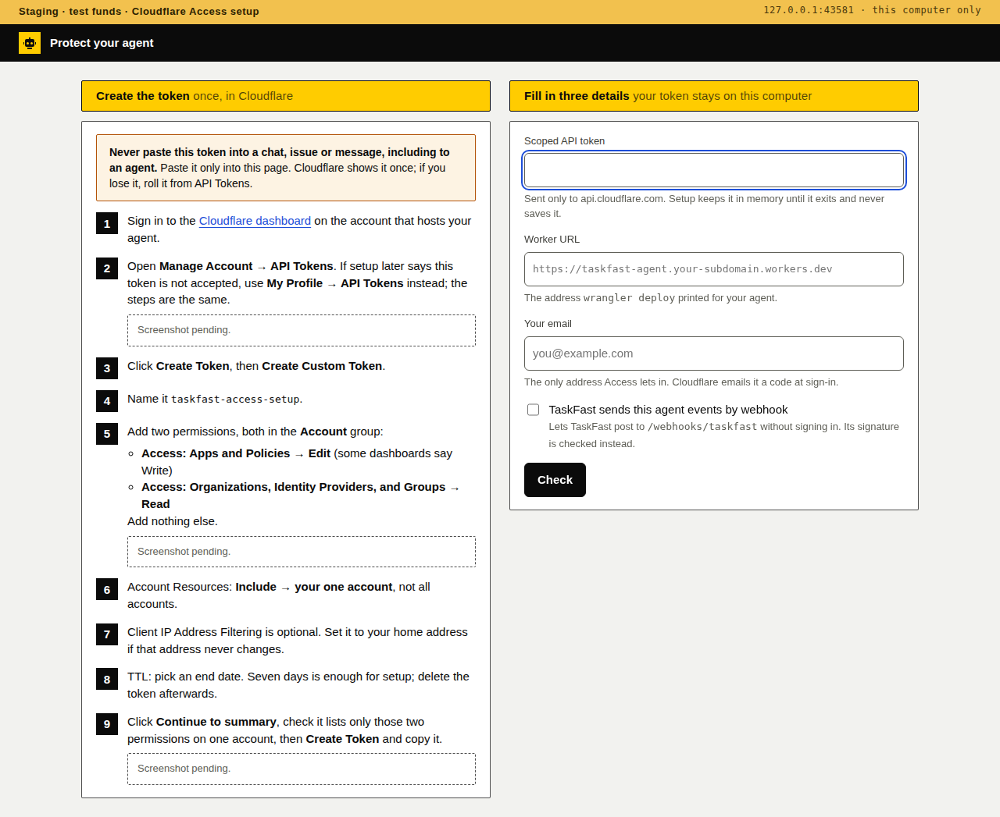

# The Durable Object host

This is how one owner's agent runs on their own Cloudflare account (#144). It covers PR3: the Durable Object (DO) host, the Access check and the CLI Container for reads. Marketplace writes, the wallet, webhooks and R2 come in later PRs. Nothing here has run on a deployed Cloudflare account yet.

## Parts

- **The Worker** (`cloudflare/src/worker.ts`) receives every request. `gate()` in `cloudflare/src/gate.ts` checks the Cloudflare Access token, then the console token, before any DO is touched.
- **The Agent DO** owns the agent's store. `agentHost()` in `cloudflare/src/host.ts` opens it with `openMarketplaceAgent`, on the DO's SQLite storage through Pi's `openDurableObjectSqliteStorage`. A DO is single-instance, so it takes the place of the local owner lock.
- **The CLI Container** (`cloudflare/cli/`) runs the pinned `taskfast` release behind one route, `POST /run`. Each call gets a fresh folder holding only the agent's TaskFast config, which the Container deletes afterwards. Only the Agent DO's binding reaches it.
- **The marketplace path** is `containerCommand()` in `cloudflare/src/container.ts`. It sends only the read tools' commands (`READ_COMMANDS`) and refuses every other command before anything leaves the DO. It maps the CLI's stdout with the same `cliOutcome` as the local host, so `REFUSED` keeps its meaning.

Secrets, set with `wrangler secret put`: `CONSOLE_TOKEN` (64 hex characters, the console page's bearer token), `TASKFAST_CONFIG` (the text of the agent's `.taskfast/config.json`) and `MODEL_SETTINGS` (a JSON object of provider settings, like the folder's `.env`). Vars in `wrangler.jsonc`: `AGENT_ID`, `CLI_ENV` (`prod`, `staging` or `local`), `ACCESS_TEAM_DOMAIN` and `ACCESS_AUD`. The owner's `agent.json` and `INSTRUCTIONS.md` go in the git-ignored `cloudflare/agent/` folder and are bundled at deploy.

A provider setting that names a file, such as a Google Vertex credentials file, does not work from a secret. Use a provider whose key is a plain setting.

## DO lifecycle

| State | Event | Outcome | Test |
|---|---|---|---|
| New instance | Constructor | Sets an alarm for now if none is set | `smoke.mjs` (local workerd) |
| New instance | First request or alarm | Loads the spec and secrets, opens the store, runs `policy.initialize`, which reads `me` and binds identity | `host.test.ts` "opens the store once" |
| Opening | A second request arrives | Waits for the same open; the store opens once | `host.test.ts` "opens the store once" |
| New instance | A secret is missing or malformed, or `me` fails | Stopped with the reason; the roster shows it, the view answers 409 | `host.test.ts` "shows a stopped agent"; `smoke.mjs` |
| Stopped | Next request or alarm | Tries to open again | `host.test.ts` "shows a stopped agent" |
| Stopped | Alarm | Retries in 60 s. A misconfigured deployment wakes once a minute until it is fixed | `host.test.ts` "shows a stopped agent" |
| Open | Alarm | `ping()`, then waits until idle inside the alarm, then schedules the next check after `pollIntervalMinutes` | `host.test.ts` "runs one work check" |
| Open, paused | Alarm | `ping()` starts no turn; reschedules | covered by `ping()` in `src/core/agent.ts` |
| Open | The model calls a write | Policy reserves, the command is refused before it leaves the DO, policy releases it as `failed` | `host.test.ts` "runs one work check" |
| Open | A read reaches the Container and the CLI refuses it | `failed`, as on the local host | `container.test.ts` "keeps a captured refusal" |
| Open | The Container is unreachable, answers non-2xx, or its reply is unreadable | `uncertain`; for a read the tool fails and the turn continues | `container.test.ts` "is uncertain when" |
| Open | Session fails | Stopped with the reason; the next request reopens | `host.ts` (`closed` handler) |
| Evicted between reservation and dispatch | Next instance opens | `policy.initialize` turns `reserved` into `uncertain`, counted as spent | core policy tests; the DO-specific run waits for writes in PR4 |
| Evicted mid-turn | Next instance opens | The conversation resumes from Pi's store; the alarm runs the next check | `spikes/cloudflare/restart-proof.mjs` |
| Open | Alarm cut off by a deploy or its 15-minute wall-time limit | The alarm set a retry in 60 s before the turn started, so the next check still runs | not run; needs a deploy |
| Restarted | Owner reads | The same ledger and transcript | `smoke.mjs` restart rows |

## Access and the console token

| Request | Outcome | Test |
|---|---|---|
| No `Cf-Access-Jwt-Assertion` header | 403; no DO is touched | `gate.test.ts`, `smoke.mjs` |
| Malformed token, `alg` other than RS256 | 403 | `access.test.ts` |
| Signed by an unknown key or another key | 403; an unknown key ID refetches the team's keys once | `access.test.ts` |
| Expired, or not valid yet | 403 | `access.test.ts`, `smoke.mjs` |
| Wrong `aud` | 403 | `access.test.ts`, `smoke.mjs` |
| Wrong `iss` | 403 | `access.test.ts` |
| The team's certs endpoint fails | 403 | `access.test.ts` |
| Valid, page path | The console page with its content policy | `gate.test.ts` |
| Valid, `/api/` without the console token | 401 | `gate.test.ts`, `smoke.mjs` |
| Valid, any method but GET | 405 | `gate.test.ts`, `smoke.mjs` |
| Valid, another site's `Origin` | 403 | `gate.test.ts` |
| Valid, `/api/agents` or `/api/agents/<id>` | Forwarded to the Agent DO | `gate.test.ts`, `host.test.ts` |
| `CONSOLE_TOKEN` secret missing or malformed | 500 | `gate.test.ts` |

The webhook route (PR5) must sit outside the Access check and verify its own HMAC.

## Setting up Access

The owner never configures Access in the Cloudflare dashboard. They create one scoped API token once, then run:

```bash
pnpm setup-agent cloudflare-access
```

It opens a page at `http://127.0.0.1:<port>/#token=<link token>` for 15 minutes. The page asks for the token, the Worker URL and the owner's email. **Check** shows what exists and what setup would make, and writes nothing. **Create** then does three things. It makes a self-hosted Access app for the Worker's hostname with one Allow policy for exactly that email. It writes the team domain and the app's AUD tag into `ACCESS_TEAM_DOMAIN` and `ACCESS_AUD` in `wrangler.jsonc`. It runs `wrangler deploy --containers-rollout=none` with the owner's own Wrangler login. With the webhook box ticked it also makes a Bypass app for `/webhooks/taskfast`.



Wrangler cannot do this itself. Its OAuth login has no Access scope, and `wrangler login --scopes` accepts only its fixed list. So the token is the one extra consent.

The token is held in memory until setup exits and is sent only in the `Authorization` header to `api.cloudflare.com`. It is never logged, saved, echoed in a response or the page, or passed to Wrangler. Scripted runs read it from `CLOUDFLARE_ACCESS_TOKEN`, never `CLOUDFLARE_API_TOKEN`, which Wrangler would use in place of its login:

```bash
node cloudflare/provision.mjs --worker-url https://<worker>.<subdomain>.workers.dev --email <you> --dry-run
node cloudflare/provision.mjs --teardown
```

`cloudflare/.access.json` (mode 0600, git-ignored) records the account, hostname, team domain, AUD tag and app IDs. A rerun finds the apps by those IDs, or by the hostname and setup's app name when the file is gone, and changes nothing that is already right. Teardown deletes only the recorded apps that still cover their hostname. The policies are inline, so deleting an app deletes its policy.

### Creating the token

Never paste the token into a chat, issue or message, including to an agent. Paste it only into the setup page.

1. Sign in to the Cloudflare dashboard on the account that hosts the agent.
2. Open **Manage Account → API Tokens**. If setup says Cloudflare does not accept the token, use **My Profile → API Tokens** instead. (Screenshot pending.)
3. Click **Create Token**, then **Create Custom Token**.
4. Name it `taskfast-access-setup`.
5. Add two permissions in the **Account** group: **Access: Apps and Policies → Edit** (some dashboards say Write) and **Access: Organizations, Identity Providers, and Groups → Read**. Add nothing else. (Screenshot pending.)
6. Set Account Resources to **Include → your one account**.
7. Client IP Address Filtering is optional.
8. Set a TTL. Seven days is enough for setup; delete the token afterwards.
9. Click **Continue to summary**, check it lists only those two permissions on one account, then **Create Token**. (Screenshot pending.)

The dashboard screenshots for steps 2, 5 and 9 come from the TaskFast team, captured on a test account with every identifier removed. Until then the page shows a "Screenshot pending" slot for each.

| Setup meets | It does | Test |
|---|---|---|
| A foreign `Host` or `Origin` | 403 | `provision.test.ts` |
| A missing or wrong link token, including another site's form post | 401 | `provision.test.ts` |
| A second request while one runs, or Create before Check | 409 | `provision.test.ts` |
| A Worker URL that is not `https://<name>.<subdomain>.workers.dev`, or not the `name` in `wrangler.jsonc` | Refused before any Cloudflare call | `provision.test.ts`; `provision.mjs` |
| A token Cloudflare rejects, or one missing a permission | Names the missing permission; nothing is written | `provision.test.ts` |
| No Zero Trust organization | Says to open Zero Trust once to create the team | `provision.test.ts` |
| An Access app for the hostname that setup did not make | Refuses and leaves it alone | `provision.test.ts` |
| A different owner email than the app lets in | Changes the policy only after the owner confirms | `provision.test.ts` |
| The deploy fails after the app exists | The app is already recorded; a rerun only redeploys | `provision.test.ts` |
| The link's 15 minutes pass | The page stops answering and setup exits | `provision.test.ts` |

`findAccount` lists `/accounts` with the token and needs exactly one. Whether an account token with only these two permissions can list its account has not run against Cloudflare; `--account-id` or `CLOUDFLARE_ACCOUNT_ID` skips the lookup. No part of this has run against a live Cloudflare account yet.

## What the console shows

The page is the local console's page, unchanged. It needs the console token as a `#token=` link, so the owner opens `https://<worker>/#token=<CONSOLE_TOKEN>` once after signing in through Access. Its live stream (`/stream`) is not served yet, so the page polls every 3 s. Host facts (the wallet balance, stream state and dead letters) are absent, so those cards stay empty. Every write control answers 405 until writes land.

## Checks

From the repository root, `pnpm check` runs the Node tests under `cloudflare/src/`. `cloudflare/src/worker.ts` imports `cloudflare:workers` and is left out of the root typecheck.

From `cloudflare/`, after `pnpm install --ignore-workspace` and with the agent files in `cloudflare/agent/`:

```bash
node smoke.mjs ../agents/<staging agent>
```

It runs the Worker, the DO and the Container under `wrangler dev`, with a stand-in Access key server, then restarts workerd on the same storage. It refuses a production config. Stop that agent's local host first.

On the machine this was built on, local `wrangler dev` cannot start any Container, including Cloudflare's minimal example: Docker creates the proxy container and never the app container. The Access and console-token rows passed there in real workerd. The Container image passed on its own (`POST /run` answered `taskfast 0.21.0`). The read through the Container from the DO has not run end to end.
