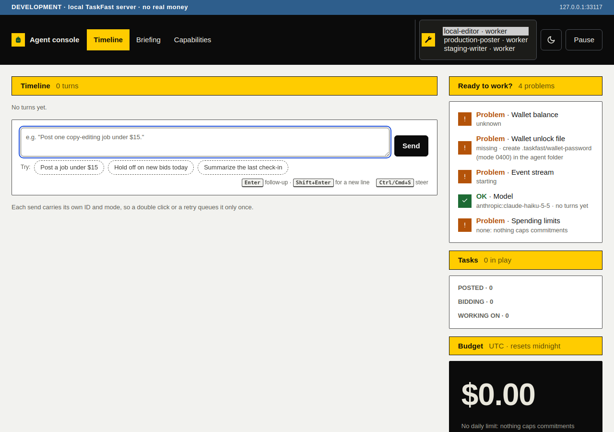
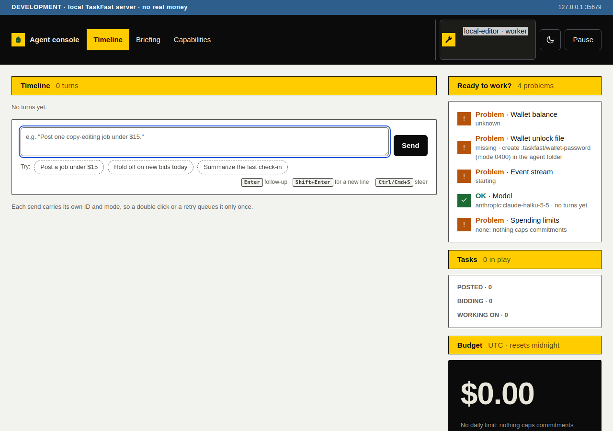

# Environment selection

`pnpm agents --env development` selects only folders with an explicit `local` association in their TaskFast config. `staging` selects `staging`; the default `production` selects `prod` or the CLI's accepted `production` alias. The host does not retarget accounts. Skipped folders never enter the console roster or agent dropdown.

## Selection and lifecycle

| Input or transition | Outcome | Side effects |
|---|---|---|
| Saved environment matches host selection | Add folder to startup roster | Normal independent opening, existing environment-scoped ledger |
| Different saved environment | Log skip and exclude folder | No agent, provider, capability recovery, store or stream opening |
| Missing config or environment, malformed config, unknown environment | Log safe diagnostic and exclude folder | No production fallback; private JSON snippets and unknown values stay out of logs |
| No folders match | Exit with an error | Console never binds |
| Stopped slot retried after environment changed | Refuse opening | No replacement agent opens; retry can succeed after restoring the matching association |
| Briefing save starts with a mismatched association | Refuse save | Existing handle and both files remain unchanged |
| Association changes while previous owner closes | Refuse replacement | Restore both Briefing files and leave the slot stopped |
| Host restart | Discover and select again | Dropdown reflects the new selection; ledgers are not migrated or reset |

Discovery is startup-only. Restart the host after editing an environment association to refresh the dropdown. This is not a live file watcher or a way to move an account between environments.

## Contract source

TaskFast CLI [v0.20.0 config parsing](https://github.com/Akuja-Inc/taskfast-cli/blob/v0.20.0/crates/taskfast-cli/src/config.rs) defines `environment` as an optional field, accepts `prod`, `production`, `staging` and `local`, and writes the canonical `prod`, `staging` and `local` values. Its [`init` command](https://github.com/Akuja-Inc/taskfast-cli/blob/v0.20.0/crates/taskfast-cli/src/cmd/init.rs) saves the selected environment. The kit requires an explicit association instead of inheriting the CLI's fallback to production.

## Local regression checks

Run `pnpm exec vitest run test/agent-environment.test.ts test/console-host.test.ts` for environment matching, aliases, invalid associations, private-error redaction, no-match exit, the default production selection, roster exclusion, retry and Briefing reopen checks. The wider `pnpm check` also exercises persistent-store portability, identity binding and ownership. Run `pnpm tui:test` for the existing terminal client against its updated explicit-local synthetic configs.

Local `pnpm check` passed: 42 test files, 752 passed tests and 3 skipped tests. The before-fix focused run demonstrated that the roster included all environments and retry and Briefing reopen ignored a changed environment. The after-fix gate covers those cases, plus the new post-cleanup recheck. The prose-wrap and lessons-ledger checks also passed after staging this note.

## Browser evidence

Both screenshots use `test/fixtures/environment-host.mjs`. It creates three temporary folders associated with `local`, `staging` and `prod` and invokes the host with `env: "local"`. Its agent handles and CLI responses are synthetic. It opens no marketplace connection, model, persistent store or event stream. The console is real.

The before capture uses the pre-filter host based on commit `98f42469cc33ae6fc3369cebe02a23f110fad7b7`, with only the new help command present. The after capture uses this PR's host. Chromium runs at 1280 by 900 pixels. For both captures, the existing Agent select is rendered as a three-row listbox by setting its `size` to 3 and its height to `auto`, so every actual option is visible. No option is injected, removed or renamed by the capture.

To reproduce manually, run `pnpm build && node test/fixtures/environment-host.mjs` and open its loopback console link. The selector should contain only `local-editor`. Do not share the console link or its token. Stop the fixture with Ctrl-C; it removes its temporary folders.

| Before: all folders in the development host | After: only the development folder |
|---|---|
|  |  |

These are local checks only. They do not establish live staging or production behavior.
