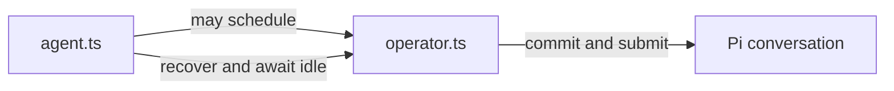

# Plan: move the operator message queue into operator.ts (#158)

Source: [issue #158](https://github.com/Akuja-Inc/taskfast-agent-starter/issues/158).

## Outcome

`openOperatorQueue` in `src/core/operator.ts` owns the queue rules: serialized admission, request-ID deduplication, the queue view, steer promotion, withdrawal tombstones, pending-steer recovery and the drain. `agent.ts` wires it and answers "may I schedule?". Queue behavior is unchanged. The module's tests open a real Pi harness and SQLite store, not a marketplace agent.



## Interface

| Member | Rule it owns |
| --- | --- |
| `admit` | One buffered entry per request ID. A tombstone or an earlier Pi submission for that ID wins. |
| `read` | Pi inbox placements, buffered messages and pending promotion intents, in admission order. |
| `promote` | Buffered follow-up becomes a steer in place. A Pi-queued follow-up gets a durable intent before Pi abort. |
| `withdraw` | One transaction settles queued records, clears buffer and intent, and writes the tombstone. |
| `recoverSteers` | Finish every pending promotion before any other submission. |
| `drain` | Submit buffered messages, steers first, checking `maySchedule` before each one. |
| `idle` | Resolves when queued admissions have settled. Quiescence and close wait here. |

The host passes the Pi conversation, the committed-read handle, `maySchedule` (false while paused or held) and a log function. `agent.ts` keeps event recovery, pause and resume orchestration, scheduling holds and the fresh recovery passes after resume or a concurrent admission.

## Canon constraints

- Operator state stays session-scoped and survives reset and compaction.
- No policy, action key, reservation, spending, tool, CLI or event-ACK behavior changes.
- The version 1 operator document is unchanged. Documents without `mode`, `queuedOrder`, `pendingSteers` or `withdrawn` still read as before.
- No Pi pin, dependency, console or TUI change.

## Transition table

| State when the call runs | Call | Result | Persistent change | Test |
| --- | --- | --- | --- | --- |
| New request ID | `admit` | Buffered, order appended | Buffer entry, `queuedOrder` | `operator-queue.test.ts`: buffers an admitted message once per request ID |
| Same ID already buffered, delivered or withdrawn | `admit` | No-op | None | same file: ignores a retried send; withdraws a buffered message with a permanent tombstone |
| Host may not schedule | `drain` | Nothing submitted | None | same file: holds buffered messages while the host may not schedule |
| Host allows | `drain` | Steers first, then follow-ups | Buffer entry removed per submission | same file: holds buffered messages, then submits steers first |
| Host stops allowing mid-drain | `drain` | Rest stays buffered | None for the rest | same file: checks the host before every submission |
| Buffered follow-up | `promote` | `steered` | Buffer mode set to steer | same file: promotes a buffered follow-up in place |
| Pi-queued follow-up | `promote` | `steered` | Intent, then abort, then steer submission, then intent cleared | same file: promotes a Pi-queued follow-up exactly once |
| Pi-queued follow-up, host may not schedule | `promote` | `steered` | Intent kept, replacement waits | same file: keeps a promotion's intent and defers its replacement |
| Intent, replacement submit fails | `promote` | `steered`, failure logged | Intent kept for recovery | same file: logs, and still reports steered |
| Intent, original already placed | `recoverSteers` | Intent cleared, no duplicate | Intent removed | same file: reports already_placed for a promotion intent that lost the placement race |
| Intent, aborted or admitted stage, after reopen | `recoverSteers` | One delivery in total | Intent removed | same file: recovers a promotion interrupted after intent, aborted and admitted |
| Unknown or finished request | `promote` | `not_found` | None | same file: promotes a buffered follow-up in place |
| Buffered or Pi-queued | `withdraw` | `withdrawn` | Settle queued records, clear buffer, intent and order, tombstone | same file: withdraws a buffered message; withdraws a Pi-queued follow-up |
| Placed or finished | `withdraw` | `already_placed` | None | same file: withdraws a Pi-queued follow-up but refuses one the agent already has; reports already_placed when a withdrawal loses to placement |
| Commit fails | `withdraw` | Rejects | None, message survives reopen | same file: commits nothing when a withdrawal's commit fails |
| Document without mode, order or intent | `read`, `promote` | Read as follow-up | Additive fields only | same file: reads a version 1 document |
| Admission in flight | `idle` | Waits | None | same file: does not report idle until an admission in flight has committed |
| Store open | open a second owner | Refused | None | same file: keeps the store owned by one handle |

Full-agent and console coverage stays in `src/core/steering.test.ts`, `src/core/operator.test.ts`, `src/core/agent-quiesce.test.ts` and `test/console.test.ts`.

## Reproduce

```sh
pnpm exec vitest run src/core/operator-queue.test.ts src/core/steering.test.ts src/core/operator.test.ts src/core/agent-quiesce.test.ts
pnpm check
pnpm build
```
