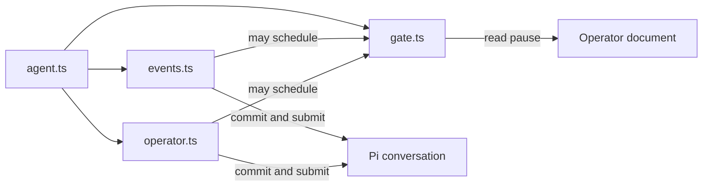

# Plan: move event work and the scheduling gate out of agent.ts (#160)

Source: [issue #160](https://github.com/Akuja-Inc/taskfast-agent-starter/issues/160).

## Outcome

`openEventWork` in `src/core/events.ts` owns durable event admission, settlement, retry delay and abandonment. `openSchedulingGate` in `src/core/gate.ts` owns transient scheduling holds, close, single-flight recovery and fresh passes. Its `mayStart` reads the owner's durable pause from `Operator`. `agent.ts` wires both modules to `openOperatorQueue`, keeps the timer and polling input, and exposes owner controls and quiescence.



## Interface

| Module and member | Rule it owns |
| --- | --- |
| `openEventWork` | Initialize the existing session-scoped version 1 `taskfast.events` document. |
| `admit` | Validate with `eventProblem`, refuse invalid events, commit one JSON snapshot per event ID before resolving. |
| `advance` | One stored-event pass. Settle submitted work, then submit due admitted events only when the host permits each submission. |
| `retry` | Only an abandoned event gets a new admitted attempt with a new request ID. |
| `read` | Return stored event records, without scheduling work. |
| `mayStart` | False when closed, held or durably paused. Recheck transient state after the pause read. |
| `hold` | Refuse a closed gate. Return an idempotent async release that requests a fresh pass. |
| `releaseInitial` | Release the optional `startHeld` hold once, without releasing other holds. |
| `run` | Join the inflight pass or start one host pass. No-op after close. Preserve rejection for the caller. |
| `runLogged` | Observe a background pass without throwing. Share failure-log dedupe with `fresh`; accept `event recovery` as the delivery prefix. |
| `fresh` | Run once when idle. When joining an older pass, run again after it settles, even if it failed. Log each failed pass once as `recovery: ...`, never reject. Concurrent observers of the same pass share its log. |
| `settled` | Await the current pass, including its rejection, without starting one. |
| `close` | Stop new passes and await the current pass, ignoring its rejection. |

The event host passes the conversation's `commit` and `submit`, the committed-read handle, context, clock, log and `maySchedule`. The scheduling host passes its committed-read handle, context, initial-hold choice, log and one recovery pass. The host serializes event `advance` through the gate. Admission and owner retry commit independently.

Every recovery pass finishes pending operator steers, advances events, drains operator messages, and only then resumes Pi when the gate permits it. A stalled queue receives at most one outstanding resume input. Polling rechecks the gate after its async inspection before submitting a check-in.

`deliver` observes background recovery through `runLogged("event recovery")` after durable admission. Explicit `recover` and `ping` may reject. Owner changes use the non-throwing `fresh` path. The periodic timer uses `runLogged()` with its `recovery: ...` prefix. The first logging observer of a failed pass supplies its prefix; other background and fresh observers do not log it again. Quiescence takes a hold, waits for the current pass, queue admissions and conversation idle, then releases through `fresh`. Close stops the gate before waiting for queue admissions and closing Pi and MCP. As before this extraction, a repeated close returns without retrying cleanup or repeating an earlier rejection.

## Canon constraints

- The version 1 event document, `EventWork` records and retry settings are unchanged. `EVENT_RETRY` allows five automatic retries, factor 2, 30-second minimum and 10-minute maximum, with jitter.
- Request IDs stay `event:${id}:${attempt}`, including the existing `event:` prefix already present in `id`. A crash after submit but before saving its ID deduplicates through Pi.
- A completed or abandoned event never resubmits automatically. Owner retry increments the attempt; another failure abandons it again.
- Admission still precedes event acknowledgement. No pump, listener or dead-letter changes.
- Pause and holds stop new model admissions, not an already running write. Policy permanence, spending and uncertain-write refusal are unchanged.
- Successful steer promotion and event retry now guarantee a fresh pass after their commit, matching resume, messages and hold release. Joining a pass that predates the change is not enough.
- No dependency, pin, fixture capture, console API, browser or TUI behavior change.

## Event transition table

All short test references below name `src/core/events.test.ts`.

| State when the call runs | Call | Result | Persistent change | Test |
| --- | --- | --- | --- | --- |
| New store or unseen event ID | Open, `admit` | Empty document, then one admitted snapshot | Version 1 document, attempt 0 | initializes an empty document and admits one JSON snapshot per event ID |
| Event ID already admitted | `admit` | No-op, original snapshot wins across reopen | None | initializes an empty document and admits one JSON snapshot per event ID |
| Invalid event | `admit` | Reject with `event refused: ...` | None | refuses invalid events before committing admission |
| Due admitted events, gate false or changes mid-pass | `advance` | Only permitted events submit | Submission ID per admitted attempt | holds admitted events and rechecks scheduling before every submission |
| Submitted, Pi queued or placed | `advance` | Wait for settlement | None | leaves queued and placed submissions alone until their runs settle |
| Submitted, Pi done | `advance` | Done, never submit again across reopen | `kind: done` | marks completed work done and never resubmits it, including after reopen |
| Submitted, failed below retry cap | `advance` | Next admitted attempt with stored jittered exponential due time | Increment attempt, `notBefore` survives reopen | persists growing jittered backoff across reopening, caps retries and logs abandonment once |
| Admitted, before due time | `advance` | No submission | None | persists growing jittered backoff across reopening, caps retries and logs abandonment once |
| Failed at retry cap | `advance` | Abandoned, one log for this transition | `kind: abandoned` | persists growing jittered backoff across reopening, caps retries and logs abandonment once |
| Abandoned, including after reopen | `advance` | No-op, no repeated log | None | persists growing jittered backoff across reopening, caps retries and logs abandonment once |
| Abandoned | `retry` | One new admitted attempt, later failure abandons again | Increment attempt, clear old submission and delay | persists growing jittered backoff across reopening, caps retries and logs abandonment once |
| Missing or not abandoned | `retry` | Reject | None | refuses retry for missing, admitted, submitted and done events |
| Submit committed but event record not saved | Reopen, `advance` | Same Pi request and submission, no second model run | Save existing submission ID, then done | dedupes the request after interruption between submit and saving its ID |

## Gate transition table

All short test references below name `src/core/gate.test.ts`.

| State when the call runs | Call | Result | Test |
| --- | --- | --- | --- |
| Unpaused, paused, held or closed | `mayStart` | True only when open, unpaused and unheld | stops new work while paused, held or closed |
| Pause snapshot in flight, hold or close lands | `mayStart` | False | rechecks holds and close after reading the durable pause |
| Nested holds | Release either, repeat release | Only that hold clears once, fresh pass runs once | keeps nested holds independent and releases each one only once |
| Initial hold plus another hold | `releaseInitial`, repeat | Initial hold clears once, other hold stays | releases the initial hold once without releasing another hold |
| Pass in flight | `run`, `settled` | Join the same pass, wait for completion | runs single-flight and settled waits for that pass |
| Idle or older pass in flight | `fresh` | One new pass, or join then one fresh pass | fresh runs one pass when idle, but joins then reruns an inflight pass |
| Multiple observers of an older pass | Concurrent `fresh` | Share the joined pass and fresh rerun | concurrent fresh callers share both the joined and fresh passes |
| Failed pass observed by owner changes | `fresh` | Resolve, log once per failed pass | fresh logs a failed pass once and never rejects |
| Failed pass observed directly | `run` | Reject without internal logging | run rejects without logging so its caller keeps the error boundary |
| Timer and owner change observe the same failure | `runLogged`, `fresh` | Resolve, share one failure log | background recovery and fresh observers log the same failed pass only once |
| Delivery and other observers share a failure | `runLogged("event recovery")` | Keep the first observer's prefix, log once | keeps the event recovery prefix without logging another observer's failure twice |
| Failed pass in flight, fresh waiting | `close` | Wait, ignore failure, no fresh rerun | close waits for a rejected pass, ignores it and stops fresh reruns |
| Closed | `hold` | Throw `the agent is closed` | stops new work while paused, held or closed |
| Held then closed | Release or `releaseInitial` | Clear hold without running work | does not run a hold release after close |

Full-agent coverage stays in `test/event-lifecycle.test.ts`, `src/core/agent-quiesce.test.ts`, `src/core/operator.test.ts`, `src/core/steering.test.ts`, `src/core/operator-queue.test.ts` and `test/console-host.test.ts`. Existing tests change imports only.

## Agent wiring regressions

The tests in [agent-recovery.test.ts](../../src/core/agent-recovery.test.ts) run real agent controls, Pi submissions and SQLite while holding the tail of a recovery pass.

| State when the call runs | Call | Result | Test |
| --- | --- | --- | --- |
| Buffered follow-up, old drain already finished | `steer` | Fresh drain submits the promoted message | steer starts a fresh drain when it joins a pass whose drain already finished |
| Old pass already observed abandonment | `retryEvent` | Fresh pass submits the newly admitted attempt | event retry starts a fresh pass after joining one that already saw abandonment |
| Timer pass fails while owner admission joins | `message` | One failure log, fresh pass drains the admission | logs one recovery failure when the timer and an owner action join the same pass |
| Cleanup failed on the first close | `close` again | No retry and no repeated rejection | reports a close failure once without retrying cleanup on subsequent closes |

Mutation checks replaced each control's `gate.fresh()` with `gate.run()` separately. Each corresponding integration test failed on the missing model run. Both changes were restored before final validation.

## Reproduce

```sh
pnpm exec vitest run src/core/events.test.ts src/core/gate.test.ts src/core/agent-recovery.test.ts test/event-lifecycle.test.ts src/core/agent-quiesce.test.ts src/core/operator.test.ts src/core/steering.test.ts src/core/operator-queue.test.ts test/console-host.test.ts
pnpm typecheck
pnpm check
pnpm build
```
