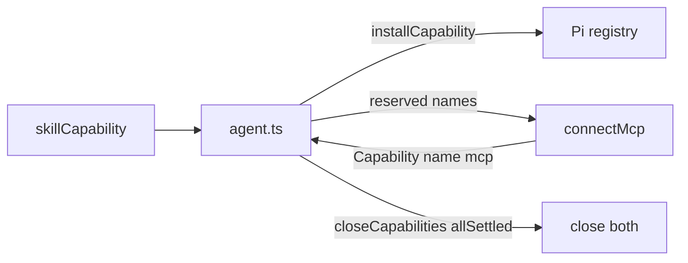

# Plan: one Capability shape for skills and MCP (#161)

Source: [issue #161](https://github.com/Akuja-Inc/taskfast-agent-starter/issues/161).

## Outcome

`src/core/capability.ts` owns the `Capability` shape and `installCapability`, so `agent.ts` installs skills and MCP from one list instead of two bespoke assembly paths. `skillCapability` in `src/core/skills.ts` owns the `skill_read` tool moved verbatim from `agent.ts`. `connectMcp` returns a `Capability` named `mcp`. Behavior is unchanged: same extension and section names, same install order, same tool and prompt content, same reserved-name snapshot and close semantics.

## Interface

| Member | Rule it owns |
| --- | --- |
| `Capability` | One runtime add-on beyond the marketplace tools: `name`, `tools`, `prompt`, `status()`, `close()`. |
| `installCapability` | Install `{ name, tools, sections: [section(name, () => prompt, { tag: false })] }`. Installs nothing when `tools` is empty, so an empty capability carries neither tools nor a prompt section. |
| `skillCapability` | `skill_read` with its fixed `skills` closure, `replay: "safe"`, sequential execution and the root-conversation refusal, plus the skills prompt. No skills means no tools and an empty prompt; `status` is `[]`; `close` is a no-op. |
| `connectMcp` | Unchanged connection, fingerprint approval, redaction and env rules, wrapped as a `Capability` named `mcp`. |
| `closeCapabilities` | `Promise.allSettled` over every capability's `close`, rethrowing the first rejection after all settle. Both close sites in `agent.ts` use it. |

## Contract

- Skills install through `installCapability` before `connectMcp` reads `registry.snapshot().tools()`, so `skill_read` is in the reserved names MCP checks against. `AGENTS.md` records this as a rule the code depends on.
- `Capability.prompt` is built once at open. Pi re-renders the frozen section every turn, so prompt content is the same text the old per-open closures produced.
- `capabilityConnections()` flat-maps `status()` over the list. Skills contribute nothing, so the output equals the old `mcp.status()`.
- `Capability.prompt` being a static string is a written limit: a third capability kind that reads live state per turn, the way the `marketplace` section does, needs `capability.ts` to grow first.
- The `Capability` name covers runtime add-ons only. The owner's management view in `src/capability-types.ts` and `src/capabilities.ts` is a separate concept; CONTEXT.md does not define either term yet.

## Canon constraints

- `skill_read` never goes through the marketplace policy and keeps `replay: "safe"`. Pi still answers a stored call to it as unavailable after the skills are removed.
- MCP tools keep fingerprint approval at open, `replay: "unsafe"`, no reconnect or tool-list refresh, `inheritEnv: false` and unlogged stderr.
- No tool, command, prompt text, fixture capture, Pi pin, console API or TUI behavior change.
