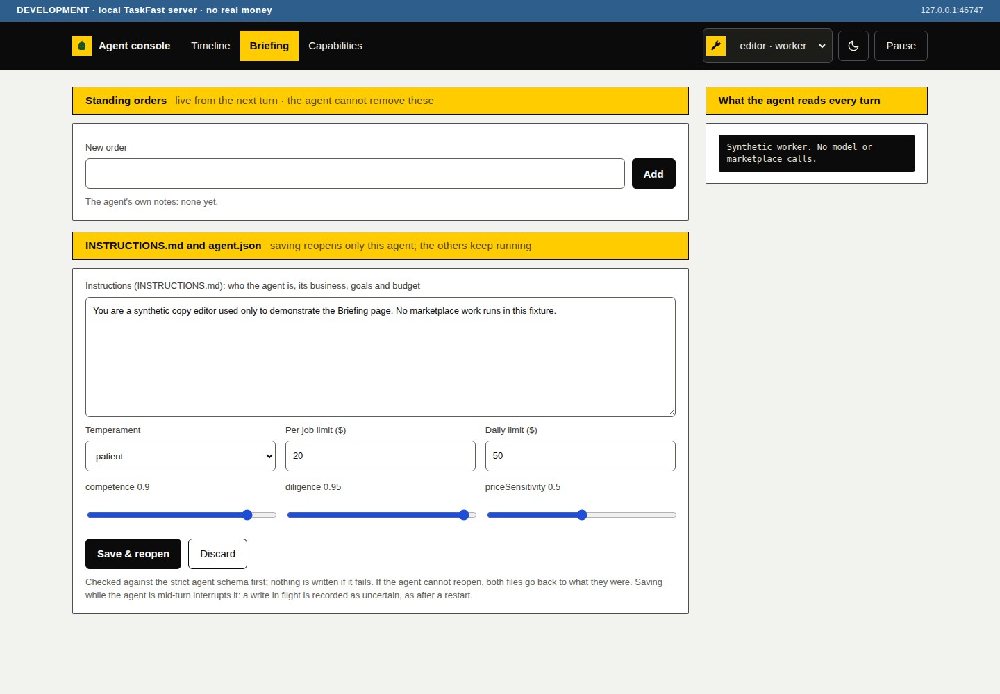
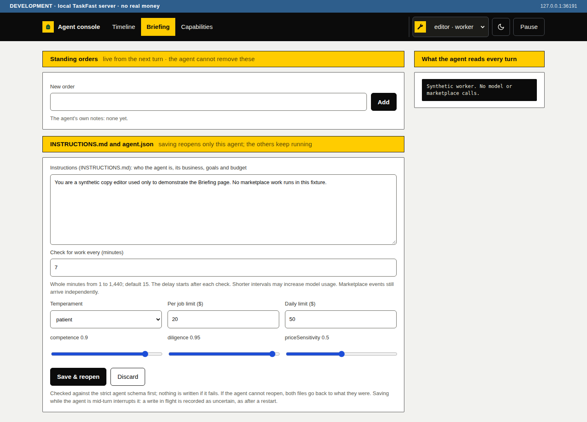

# Configurable work checks

Issue #100 adds `pollIntervalMinutes` to each agent's `agent.json` and the browser's Briefing page. The owner chooses whole minutes from 1 to 1,440. Missing values keep the 15-minute default without rewriting old files. The first check is immediate, and the delay starts after each `ping()` returns. An explicit embedding host `RunOptions.pingEveryMs` takes precedence. Briefing shows a notice when that override differs from the saved setting.

Saving uses the existing Save & reopen flow. It interrupts the selected agent as before, with the existing warning about uncertain writes. It does not reopen siblings, change event delivery or alter pause and spending controls. The TUI preserves the field when editing other fields but does not edit this browser-only control.

## Lifecycle and failure coverage

| State and input | Outcome | Local regression test |
| --- | --- | --- |
| Old agent file omits interval | Immediate first check, then a 900,000 ms delay; no default field added to the file | `test/poll-interval.test.ts`, `test/polling-host.test.ts` |
| Ready agents have different intervals | Each starts immediately and owns an independent delay | `uses independent saved delays and the legacy default` |
| One ping has not returned | Its delay has not started; a sibling still checks | `waits for each ping to finish` |
| Explicit host override is set | Override wins for all agents without changing saved intervals | `keeps an explicit host override` |
| Invalid Briefing save | Browser sends no request; direct API input returns 400; files and current timer stay unchanged | `test/console-page.test.ts`, `test/console.test.ts`, `test/polling-host.test.ts` |
| Valid Briefing save | Only the selected loop is aborted; the replacement checks immediately and uses the new delay | `persists Briefing saves, cancels only the replaced loop` |
| Host restarts after save | The saved interval is loaded from disk and used by the new loop | `persists Briefing saves, cancels only the replaced loop` |
| Reopening fails after publication | Both files are restored, the selected agent stops, and no old timer survives; a later host reads the previous interval | `restores the saved interval after a failed reopen` |
| TUI saves an unrelated field | Saved interval stays in the outgoing spec | `test/tui.test.ts` |

The host tests run the real `runAgents`, HTTP console, strict parsers, durable agent-file writes and reopen/rollback paths against temporary folders. They substitute agent handles and control only the promise-timer boundary, so no test waits 15 real minutes or contacts TaskFast. Existing policy and store code is unchanged.

Run the focused reproduction:

```bash
pnpm exec vitest run test/poll-interval.test.ts test/polling-host.test.ts test/console-page.test.ts test/console.test.ts test/tui.test.ts
```

## Browser evidence

The capture script serves the real compiled page against a synthetic loopback API. It checks the initial default, rejects zero, negative, fractional, out-of-range and empty drafts without sending a save, saves seven minutes, reloads it, and confirms that the sibling retains two minutes. It also checks light/dark themes, desktop/phone widths, a 44 px input target, its helper association and the environment banner. It does not establish disk persistence or marketplace behavior; the host tests cover disk persistence separately.

Reproduce with machine-installed Python Playwright and Chromium:

```bash
pnpm build
python3 docs/polling/capture.py
```

`browser-source.json` records the exact source commit, before commit and source hashes. The before page comes from that base commit; both pages use identical synthetic data. The after captures show the saved seven-minute interval.

| Before | After |
| --- | --- |
|  |  |

[Desktop dark](after-desktop-dark.png), [phone light](after-phone-light.png) and [phone dark](after-phone-dark.png) show the same control in the other checked layouts.

All validation is local. No live staging or production calls, model-provider calls, real agent folders or real credentials were used.
