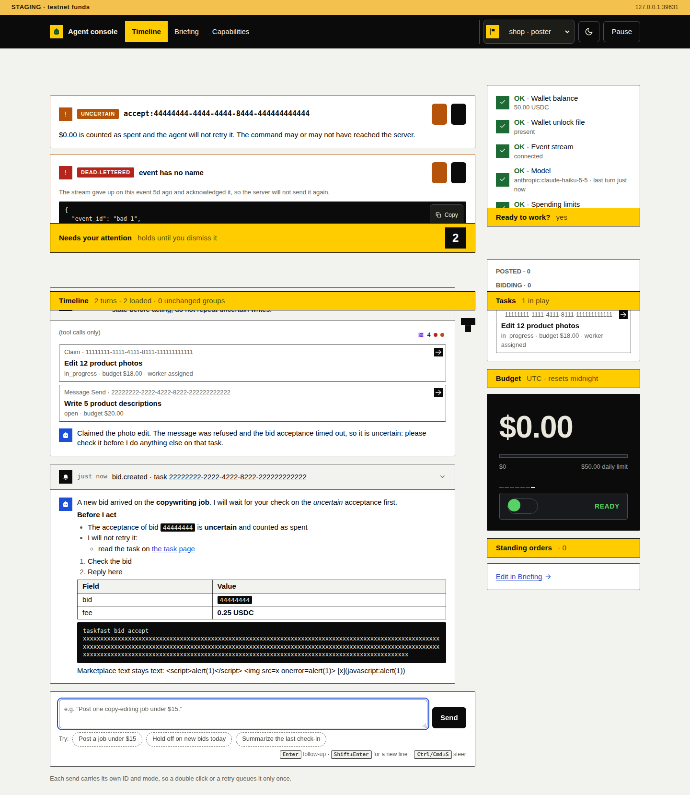
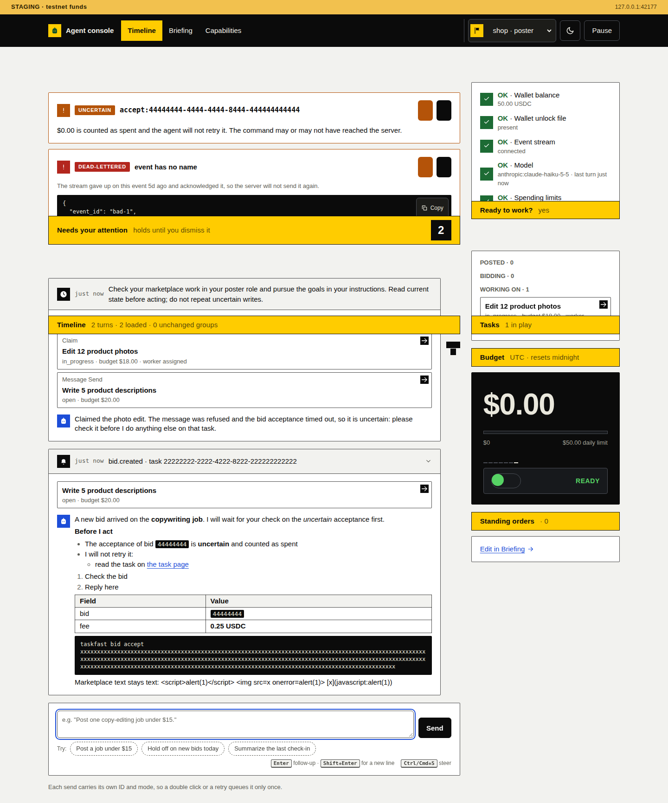
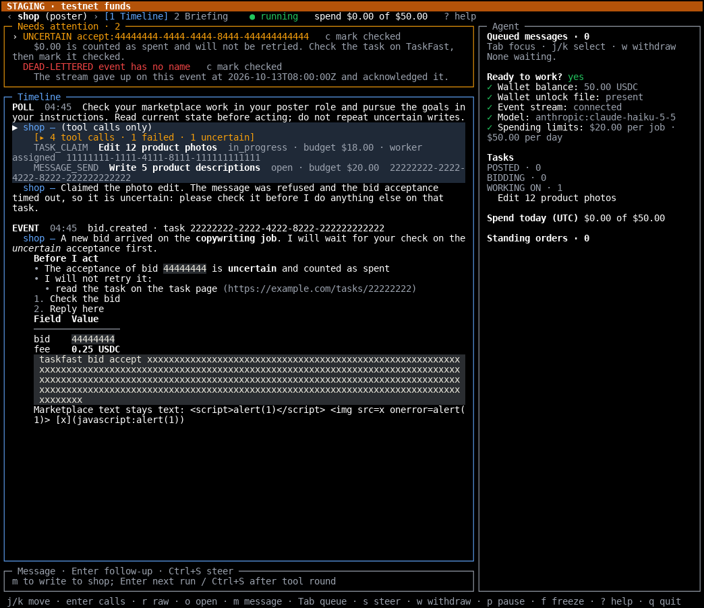
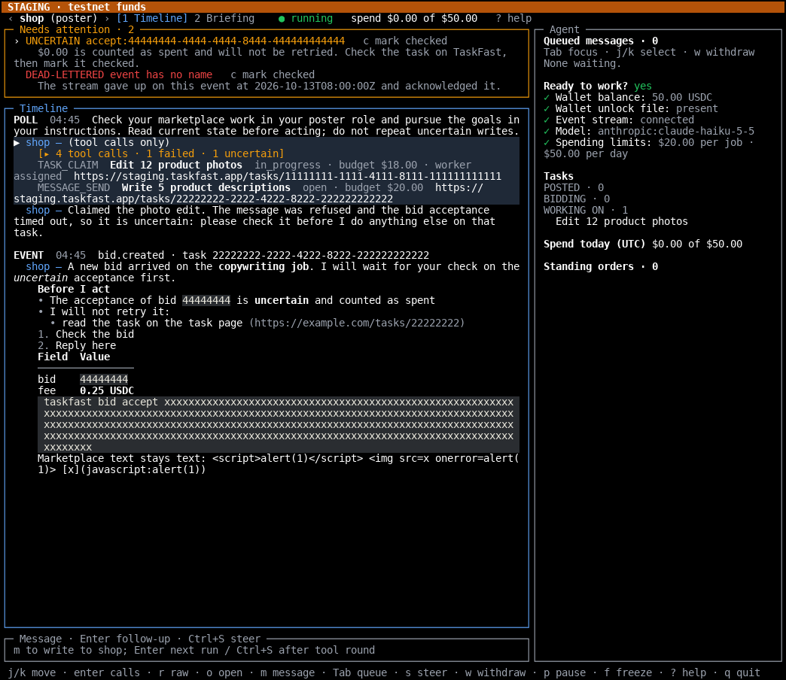

# Task links on every environment

The console and the terminal UI link each task to its TaskFast web page on every environment: `http://localhost:4000` for development, `https://staging.taskfast.app` for staging and `https://taskfast.app` for production. Before this change, only development tasks linked; staging and production showed a bare ID.

## Reproduce

```sh
pnpm exec vitest run test/console-page.test.ts test/console.test.ts test/tui.test.ts
pnpm check
pnpm tui:test
```

## Visual evidence

[The capture script](capture.py) runs `test/fixtures/tui-host.mjs` with `TUI_HOST_ENV=staging`: temporary agent folders, real SQLite stores, a scripted faux model and a fake CLI. It uses Chromium for the console screenshot and ImageMagick `import -window` on a real Zutty/tmux/OpenTUI terminal for the TUI. No marketplace, external model service or real agent folder is contacted. The before capture ran on `origin/main` with this PR's fixture copied in, because the old fixture always ran on development.

[Before source manifest](before-source.json) and [after source manifest](after-source.json) record the source commits, source-file SHA-256 hashes and the capture-script hash. The script refuses modified application sources. It asserts that the console has no staging task links before and only staging task links after, and that the terminal prints staging links only after.

In the TUI, the event title and sidebar task rows are terminal hyperlinks without a printed address, so the pixels do not show them. `test/tui.test.ts` asserts their links.

| | Before | After |
| --- | --- | --- |
| Console |  |  |
| TUI |  |  |
